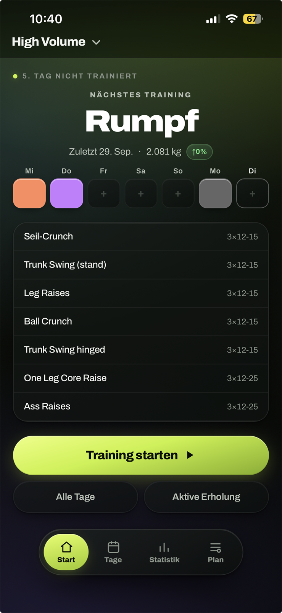
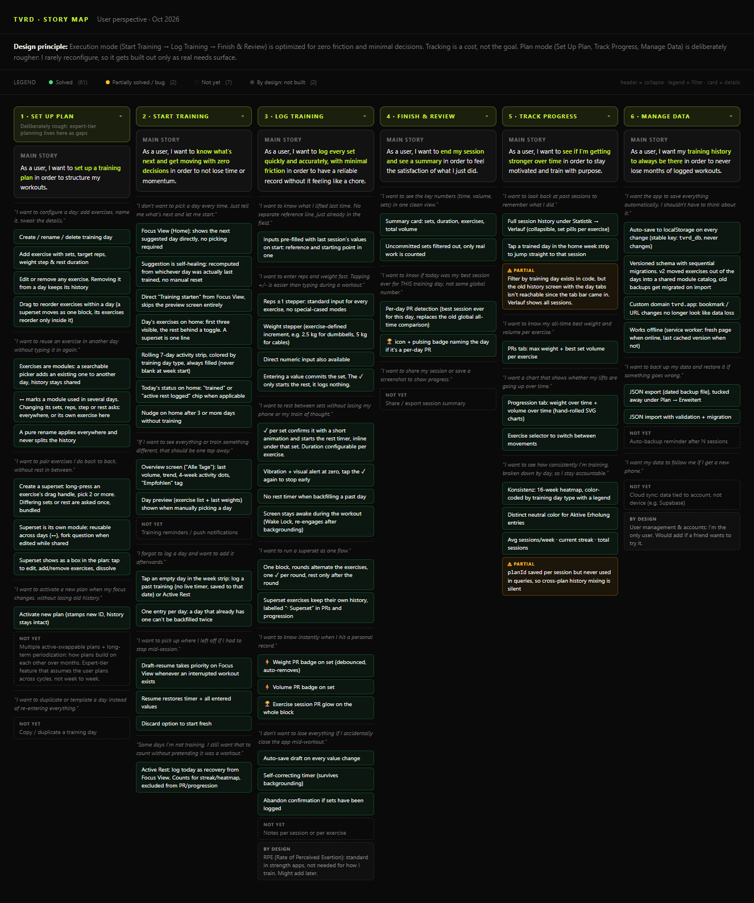
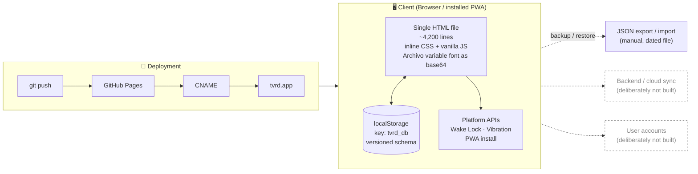
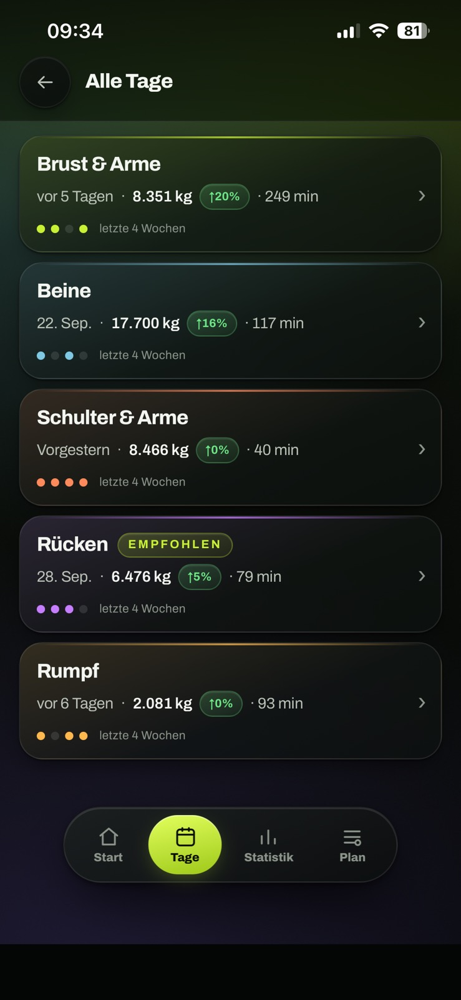
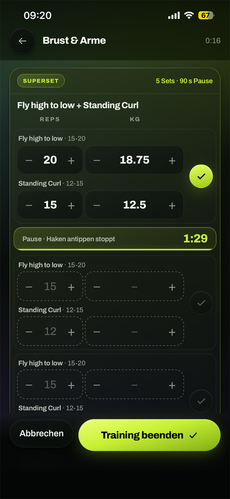

# TVRD

A training tracker I built for myself and use every session. Six workouts a week, heavy-user territory.

**Live:** [tvrd.app](https://tvrd.app). Single-file web app, installable to the home screen.

> *tvrd* is Bosnian for "hard / tough."

**n=1 by design.** I'm the only user. This isn't a product case study with a user base and dashboards. It's the tool I wanted, built and iterated in the open. What this README covers: the thinking, the built-in restraint, and how it was made.

---

## Why it exists

I tracked workouts in a Google Sheet. Entry was tedious. I tried the fitness apps and hit the same problem every time: none of them focus on the one thing I actually want to do, which is log a set as fast as possible and get back to the workout. Too many features I don't use, constant upselling, no respect for the fact that I open the app under load, not on the couch.

**A second reason showed up during the build.** Halfway through I realized this could double as a portfolio piece: how do I actually work with AI, rather than just claim to. **Function stayed the priority** and got built first. For a long stretch the design was deliberately MVP-grade: clear enough to demo, nothing more.

That changed once the function was genuinely done. The app worked exactly how I wanted, and the look was the only thing still saying "side project, theme taken off the shelf." So I did a deliberate design pass. [What that was and how it went is its own section.](#the-design-overhaul)

---

## Foundational principles

Four principles set the direction from the beginning. Each one has a specific place in the product where it shows up.

**Minimal input.** Logging should cost as few taps as possible, even if the record ends up less detailed. Any feature that touches logging has to answer one question first: does it cut taps? That's why there's no RPE rating per set and, so far, no notes. If RPE ever reaches a 4 or 5 on the pain scale below, it gets built, taps and all.

**Function first, form second, in that order, not instead of.** Every hour spent on polish while the function still had friction would have been an hour spent wrong. So the design stayed MVP-grade on purpose until the app genuinely did its job. Then form got its own pass, with the same rule applied to it: nothing that costs a tap during a set.

**Good enough is perfect.** I build when a real need surfaces, not before. Cloud sync isn't there because I train on one device. Cost/benefit, not completeness. Everything has to earn its place: each open item on the [story map](#user-story-map) carries a pain value from 0 to 5, how much its absence hurts right now. Whether it gets built is a separate call, but at 4 or 5 it usually does.

**Built for heavy users.** Assumes someone who trains often and knows their weights. Preset weight increments per exercise (2.5 kg for dumbbells, 5 kg for cables), no onboarding flow, no explainer overlays. If you don't already know what a "set" is, this isn't for you.

---

## Working hypotheses

The bigger product decisions are working hypotheses. The evidence is my own daily use, so n=1.

**Sets count as logged by default.** *(Sep 2026)* Pre-filled sets are logged from the start, and I only touch what differs. The alternative, where nothing counts until confirmed, costs a tap per set. What followed: the per-exercise progress bar started full every time, so it went. A light tint marking logged sets went unnoticed in use, so now the exception is marked instead: a set without a value shows a dashed field. *Status: holds.*

**The exercise module is the building block.** *(Sep 2026)* An exercise is a module with its own parameters and its own history, independent of the day or plan it sits in. Same movement with the same parameters is one module. Different parameters make a different one, and a superset is a module of its own. History was already stored per exercise, so the switch needed no data migration. *Status: has held up so far.*

**Periodization comes from the modules.** *(Oct 2026)* Plans are built from modules, and a module keeps its history from plan to plan. Running plans one after another already is periodization, so a separate layer for planning across plans would add nothing. I keep several plans and switch with one tap, and the progression chart follows a module across plans, so the cycle stays visible. *Status: follows from the module hypothesis.*

---

## How the focus mode works

Every decision below exists to reduce something specific I noticed getting in my way.

**No choosing.** The home screen shows the next training day directly. No picker, no calendar view first. One button: *Training starten*.

**The suggestion heals itself.** The app rotates through the plan, but it recomputes from whichever day I actually trained last. Skip a day, train out of order, come back after a week, and it picks up from wherever I am. No manual reset.

**Inputs are pre-filled with the last session's values.** Reps and weight are already in the field when the workout starts. Same weight? One tap and done. Small change? Tap `+` twice. That's usually the whole interaction.

**Big steppers for reps and weight.** A `−` and `+` on either side of a large number, sized for a sweaty thumb. Typing on a phone keyboard during a set is friction I don't accept. Direct numeric input is still there if I need it.

**Weight increments are preset per exercise.** Dumbbell exercises step in 2.5 kg. Cables step in 5 kg. I set this once when I built the plan, and from then on `+` moves by the right amount. No "which weight is next" math mid-set.

**Entering a value commits the set.** No confirm step. A set without a value yet shows a dashed field, so the one thing that still needs input stands out.

**The checkmark starts the rest.** Each row has a `✓`. It doesn't log anything, the values already did that. Tapping it confirms the set with a short animation and starts the rest timer, which slides open right under that set. Tap the `✓` again to stop it. Same single tap the old ⏱ button needed, it just feels better.

**Supersets run as one block.** Two or more exercises back to back, no rest in between. In the workout they show up as rounds: every exercise of a round stacked, one `✓` per round, rest only after the round.

**Screen stays awake mid-workout** (Wake Lock API), and re-engages automatically if I background the tab. My phone never locks in the middle of a set.

**Pause by minimizing.** Swipe the workout down or tap ⌄ and the whole session pauses, clock and rest timer included. A bar above the tab bar brings it back with one tap. Every value is still saved the moment I enter it, so if the app gets closed mid-set, it reopens right in the workout.

**No decorations during the set.** No motivational quotes, no confetti on every rep, no ads. When I hit a PR, the badge appears for two seconds and self-removes. That's the entire ceremony.

---

## The design overhaul

For most of this project the design was a placeholder. It worked, it was legible, and it looked like every dark-mode template on the shelf: flat near-black, one accent colour, 12px corners, no depth. Once the function was genuinely done, that was the only thing left that still read "side project."

So I set an explicit goal: **it should be obvious this is a 2026 design, not a 2019 one.** I collected two reference apps I liked and named what I liked about them: colour transitions, the buttons, and the shading. That was the whole brief.

### What guided it

**Dark stays dark.** Both my references were light-themed. Copying them literally would have produced a bright app, and I open this in a dimly lit gym at 6am. The techniques transfer to dark; the palette doesn't.

**Readable beats impressive.** Every colour decision got measured, not eyeballed. The rule was a 4.5:1 contrast floor for anything I have to read mid-set, and it killed several things that looked better than they read. White glass copied from the references dropped secondary text to 2.15:1, so the cards became dark glass (5.1:1). And the gradient only goes as strong as the labels sitting directly on it can take, measured against its brightest point.

**Nothing costs a tap.** Same rule as the rest of the app. No animation that delays input, no decoration that eats a touch target, no state where the primary action moves.

**One layer, not a patchwork.** The visual language lives in design tokens, so every screen changes together and stays consistent. No screen-by-screen restyling that drifts apart six months later.

### The language we landed on

**A gradient surface instead of flat black.** A fixed backdrop with the accent lime glowing from the top right and a cool counterpoint below, plus fine grain so it doesn't band on OLED. Content scrolls over it; the surface stays put.

**Dark glass.** Cards are translucent and blurred, with a light catch along the top edge. That edge is what separates "glass" from "dark rectangle." Three tonal steps, so a card, a stepper, and the nav read as different depths.

**Pills with weight.** Buttons are fully rounded. The primary one carries a lime gradient, a coloured glow beneath it, and an inner highlight along the top, and it presses down when tapped.

**Colour that stays put.** Each training day has a colour. It used to be a stripe on the left edge; now it tints the whole card and glows from its top edge, and it looks identical in the overview and the plan editor.

**A floating tab bar.** Four destinations (Start, Days, Stats, Plan) in a glass pill at thumb height. It replaced two icons that used to sit in the top right corner, out of thumb reach. It disappears during a workout, day preview, and the finish screen: a running workout is a flow, not a place, and a mis-tap shouldn't drop me out of it.

**A typeface with a face.** Inter out, [Archivo](https://fonts.google.com/specimen/Archivo) in. Inter is the default UI font of the last decade, competent and completely anonymous, which was a large part of why the app looked generic. Archivo has a width axis, and the display runs at 116% width and weight 900. The result is unmistakably athletic in a way no weight of Inter gets to.

### How it was implemented

**Prototype before production.** The app is a single 3,000-line file that deploys live on every push. Iterating on the real thing would have meant either a stream of live deploys or days of uncommitted work. So the design language was built and argued out in a [standalone prototype](https://tvrd.app/docs/design-prototype.html) covering three screens, and only ported once it was settled. Three rounds of feedback happened there, cheaply.

**Tokens first, components second.** The existing CSS already referenced `--surface`, `--border`, `--radius` and friends throughout. Redefining those (including making the surface tokens gradients rather than flat colours) lifted all eight screens at once. Only what tokens can't express (backdrop blur, the light edge, the gradient button, the tab bar) needed real rules, and those sit in one clearly marked layer rather than scattered through the 175 existing ones.

**The font got subset and trimmed.** Full Archivo is 643 KB. Cut to Latin plus umlauts, digits and the punctuation the app actually uses, and with the variable axes clamped to the range in use (weight 400-900, width 100-125% instead of 62-125%), it lands at 50 KB. Embedded as base64 like Inter was, the swap cost 3.5 KB net. The `tnum` OpenType feature was explicitly preserved. Without it, digits jump width while a rest timer counts down.

---

## How I built it with AI

I didn't write the code. I directed it.

I set the direction, made the product decisions, and reviewed every change. Claude Code (Anthropic's CLI) did the implementation. The split is deliberate and it isn't hidden: **every recent commit in this repo is co-authored by Claude.** The git history is the honest record of how this was built.

The most useful thing I brought wasn't the code. It was using the app for real.

**A bug only daily use would catch.** The home screen told me I'd trained back "yesterday" when I'd actually trained it two days earlier. I reported exactly that. It turned out the app measured "last trained" in elapsed 24-hour blocks instead of calendar days, so a Saturday-evening session read as "yesterday" on Monday morning. The same flaw was sitting in two other places, the week dots and the consistency heatmap, where it would have drifted by a day too. Precise direction from real use turned a one-line symptom into a fix for a whole class of bug, instead of a patch on the surface.

**A bug only looking would catch.** During the design pass, every automated check passed: no clipping, no overflow, no small touch targets, contrast fine. On screen, the resume button was a lime balloon filling half the screen. A layout rule that was right inside the bottom bar was wrong in a column, and no property-level check could see that. Since then, every UI change gets verified with a screenshot, not just assertions.

That's the loop. I bring the ground truth and the judgment, the AI brings the implementation, and reviewing the output critically is the actual job. Accepting it isn't.

---

## User story map

The full picture of what the app is trying to do for the user, broken down across the whole training journey: solved, partial, deliberately not built, still on the list. Every open item carries its pain value and what it depends on.

→ **[Open the interactive story map](https://tvrd.app/docs/story-map.html)**

---

## Plan mode

Functionally rougher than execution mode, and deliberately so. I open it rarely, usually just to add or swap an exercise, so it hasn't earned the same depth of features. Same cost/benefit logic that runs the whole project: build when a real need shows up.

Supersets live here too. Long-press the drag handle of an exercise, check the ones that belong with it, done. If their sets or rest times differ, the app asks once which to use. A superset is its own module: reusable across days, and it keeps its own history. Curls in a superset put out less than curls on their own, so the numbers stay separate.

It did inherit the full visual treatment, though. That fell out of doing the design work at the token layer instead of screen by screen.

**Plans.** I can keep several plans, but exactly one is active. Home, history and stats only show that one, because a plan follows one goal and tracking two at once splits the focus. The exception is the progression chart, which follows a module across plans. Switching is one tap on the plan name. A new plan starts empty or as a copy and doesn't activate itself, the app asks at the end. Exercises stay modules across plans, so a copy keeps their history and PRs. Periodization across plans isn't a feature of its own, see [working hypotheses](#working-hypotheses).

---

## What I deliberately did not build

At n=1, knowing what to leave out is most of the work.

- **Social feed, gamification loops, a muscle-group encyclopedia.** Only what supports the actual training gets in. The home screen has one primary action.
- **Cloud sync.** `localStorage` only. A backend would let data survive a new phone; for a single-device personal tool the complexity isn't worth it yet.
- **Running several plans in parallel.** I can keep several, but only one is active at a time. See above.
- **User management / accounts.** I'm the only user. Would add if a friend wants to try it.
- **RPE (Rate of Perceived Exertion).** Standard in strength apps, where the user tags each set with how hard it felt. Useful for programming, not for how I currently train, and it costs a tap per set. Pain 2 right now.
- **Reminders / notifications.** The app doesn't nag. I open it when I train.
- **Per-muscle-group analytics.** Interesting, not needed for how I actually use it.

---

## Known limitations

Stated plainly, because a tool you use daily has real edges:

- **Data is device-bound.** `localStorage` lives in one browser on one device. The custom domain fixed the "bookmark change looks like data loss" problem, but it does **not** sync across devices. Backup and restore are manual JSON export/import.

---

## Tech

- **One HTML file.** ~4,200 lines, HTML + CSS + JS inline. No framework, no build step, no dependencies. The Archivo variable font is embedded as base64, subset to Latin + umlauts + digits, with axes trimmed to what's used (weight 400-900, width 100-125%). No network request for it.
- **Persistence:** `localStorage`, versioned schema with sequential migrations (currently v3: v2 turned exercises into shared modules, v3 added plans). Backup and restore via JSON file (manual).
- **Charts:** hand-rolled inline SVG, no charting library.
- **Platform APIs:** Wake Lock (screen stays on mid-workout), Vibration (rest-timer alert), installable PWA (standalone, custom home-screen icon).
- **Deploy:** GitHub Pages with a custom domain via `CNAME`. Push to `main` deploys.
- **No backend, no auth, no analytics.** By design. See above.

---

## Screens

  
  

